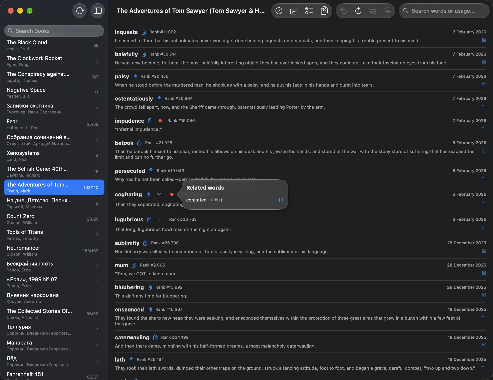
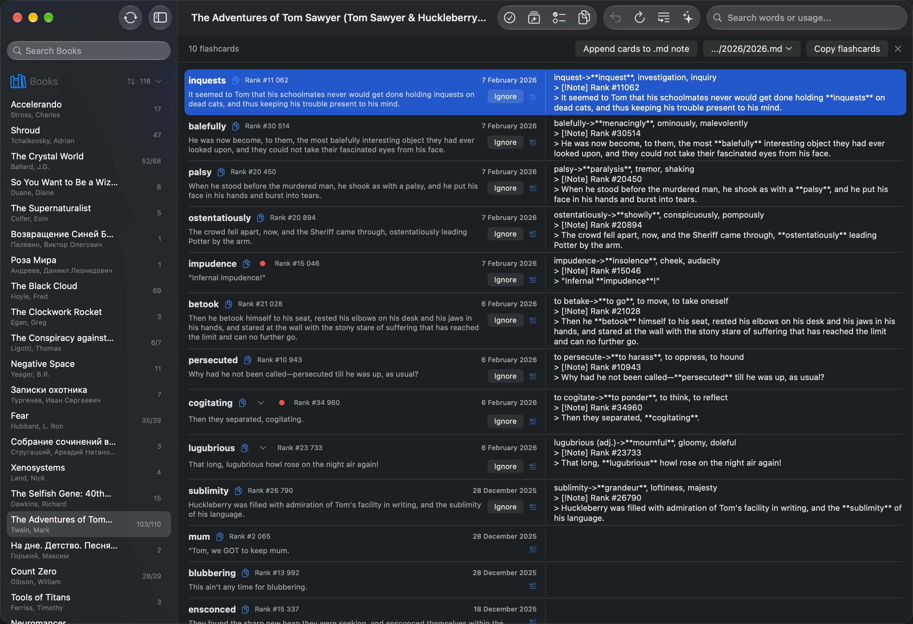
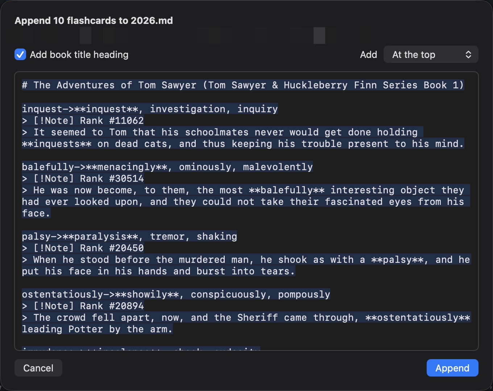

<p align="center">
  
</p>

# KindleBro


KindleBro is a small native macOS app for Apple silicon that allows you to process Kindle word lookups into finished flashcards without context switching.

It is made primarily for advanced language learners who use spaced repetition (SRS). Reading fiction is one of the most efficient ways to mine new vocabulary.


## Features
### Kindle word lookups import
- One-click sync imports `vocab.db` straight from a connected Kindle.
- If the Kindle is already connected when KindleBro starts, it syncs by itself. This is on by default and can be turned off in Settings.
- Words are grouped by book, newest first, so you can process a book in batches as you read it.
- The sort button in the Books and Completed headers orders both sections by date added (the default, most recently synced first) or alphabetically. Books synced before 1.4 are dated by their first lookup, because their sync date wasn't recorded.
- Different forms of a word in the same book, such as «vitiated» and «vitiates», are shown as one entry under the dictionary form («vitiate»). The entry keeps every form's sentences, and its status applies to all forms. Forms come from Apple's language tools (English and Russian), with Kindle's stem as a fallback for rare words.
- If the same book appears more than once (for example, words synced from two Kindles), it is shown as one book and each word appears once.
### Word processing
- Imported words start in the `Learning` state. From there you can mark them:
    - `Ignored`: words added by mistake (Kindle has no way to remove words from `vocab.db`).
    - `Mastered`: words you have already made flashcards for.
- The goal is to process every word. Once all words in a book are `Mastered` or `Ignored`, the book counts as `Completed` and moves to the Completed section, away from the books still in progress. Turning off "Enable Completed books" in Settings keeps all books in one list.
- Books in progress show `Learning/Total` in the sidebar, so you can see at a glance what is left.
- The Refresh button moves `Mastered` and `Ignored` words to the bottom of the list, which helps with batch processing in word-dense books.
- Each word comes with its usage, the sentence from the book where you looked it up. Context matters for remembering a word. If a word was looked up several times in the same book, a chevron appears and you can pick the usage to use from then on. The choice is saved per book, so the same word in another book keeps its own usage.

> [!note]  
> In my experiments, flashcards with several usages were harder to recall than cards with one, because each card held too much. So the app keeps one preferred usage per word.
- English words show `Rank #N`: how common the word's dictionary form is in fiction, where #1 is the most common word. The ranks come from Google Books English Fiction (books from 1900 to 2019) and cover the 150,000 most common dictionary forms. Rarer words show no rank. Copied words (Copy, Cmd + C, Copy with prompt, Copy all Learning words) and the words sent to Claude Code carry the rank after the word, as in `remit (Rank 18950)`, so your prompt can put it on the card. Turn this off in Settings.
- A word's status is shared across books: marking it `Mastered` in one book marks it everywhere.
- Undo reverts status changes. A batch change, such as an arrow key press on several selected words, is undone in one step.
- Automatic backup: when you quit, KindleBro can copy your whole library to a folder you choose (Dropbox or iCloud Drive, for example) using SQLite's backup API. Changing the backup settings also makes a full backup right away. If a backup fails, you get an alert; for a backup on quit, the alert appears at the next launch.

### Keyboard-driven review
- Right Arrow:
    - `Learning` → `Mastered`
    - `Ignored` → `Learning`
- Left Arrow:
    - `Learning` → `Ignored`
    - `Mastered` → `Learning`
- Esc clears the selection.
- Cmd + C copies the selected words with their primary usage.
- Cmd + Shift + P opens the prompt editor.
- Cmd + , opens Settings.
- Each word has copy icons for copying the word or its usage on its own.
- Hold Command to select several words.
- Toolbar buttons:
    - `Select learning batch` selects the first batch of `Learning` words in the current book (the batch size is set in Settings).
    - `Select all Learning words`
    - `Copy all Learning words`, with the prompt in front
    - `Copy selected words with prompt`
    - With Claude Code connected: `Generate flashcards for a learning batch` and `Generate flashcards` (for the selection)
### Search
- Book search filters the book list by title.
- Global search looks through the whole library, both words and their usages.
    - For English it also matches other forms of a word: «peeved» finds «peeve». Usage text is matched literally.
    - `%` and `_` are searched as plain characters.
    - Clicking a result opens its book and selects the word.
- Related words: words with the same dictionary form in other books are marked with a red dot. Click it to see them and jump to one. You can turn this off in Settings, along with stem-based search.
### Library
- Import a `vocab.db` from any location with File ▸ Import Database….
- You can import several `vocab.db` files into one library. Imports only add: existing word states are kept. An import either completes fully or changes nothing, and any error is shown.
- The library can be exported as a backup, including word states, preferred usages and the custom prompt.
- The library can be erased.
### Flashcards prompt
- You write the prompt that turns words into flashcards, in whatever format you need. `Copy selected words with prompt` puts the prompt in front of the words; paste the result into the LLM chat of your choice.
- Optionally, words copied with a prompt are marked `Mastered` automatically.

Example prompt:
```
For a given set of words and usage samples, generate flashcards in the following format:

word>>3 most frequent translations, ordered by descending frequency, with the most frequent translation wrapped in **bold**. After the translations, add a usage sample enclosed in backticks (``). At least one translation must be derived from the provided usage. If a word has fewer than three frequent translations, list only the available ones.  
Each flashcard must be on a new line. Do not add any text, comments, or explanations — output **only** the generated flashcards.

Example:  
test>>**translation1**, translation2, translation3 `Usage example`
```
> [!tip]  
> You can change the card format by editing the prompt.

### Flashcards with Claude
If [Claude Code CLI](https://code.claude.com/docs/en/setup) is installed on your Mac and signed in, KindleBro can generate the flashcards itself, using your Claude subscription (or the API key Claude Code is set up with). KindleBro runs the `claude` command and never sees your login.
- Turn it on in Settings ▸ Flashcards ▸ Connect to Claude CLI. KindleBro finds `claude` and checks that it is signed in. Model chooses Fable, Opus, Sonnet or Haiku (the latest of each), or leaves the choice to Claude Code.
- `Generate flashcards for a learning batch` sends the first Learning words of the book (the batch size from Settings) with your prompt. `Generate flashcards` does the same for the selected words.



- The cards appear in a column beside the word list, each on the line of its word, so you can judge which words are worth learning. Mark the others `Ignored`, with the Ignore button on the word's row (Unignore reverses it): their cards are struck through and left out.
- `Copy flashcards` copies the remaining cards, with a blank line between them. With "Mark words as Mastered when copied with prompt" on, the copied words become `Mastered`.
- Close the column with ✕, which also stops a generation still running; quitting KindleBro discards the cards too.
- Generation counts toward your Claude usage limits.

### Writing flashcards directly to Markdown notes
This part of the workflow writes the generated batch straight to `.md` files, which many SRS apps use as the source of their flashcards.

- `Append cards to .md note` adds the remaining cards to a Markdown note, such as an Obsidian note. With "Mark words as Mastered when copied with prompt" on, the added words become `Mastered`. The first time, it asks for the note. The menu next to the button lists every note chosen so far: switch between them, remove one from the list with ✕ (the file stays), or Select new….
- Before anything is written, a preview shows the note with the cards in place. Choose whether a `# Book title` heading goes over each book's cards, and whether the cards go at the top of the note (below any front matter) or at the bottom. KindleBro only adds text: what is already in the note stays as it is.



## Word frequency data
`Resources/english_ranks.txt` is built from the [Google Books Ngram Viewer](https://books.google.com/ngrams) data, version 3 (2020), English Fiction 1-grams, licensed under [CC BY 3.0](https://creativecommons.org/licenses/by/3.0/). `scripts/make_ranks.swift` rebuilds it; the steps are at the top of the script.

## Install
After installing from the `.dmg`, remove the quarantine attribute:
```
xattr -d com.apple.quarantine /Applications/KindleBro.app
```

## Local build
Run `./package.sh` to build the `.app` and the `.dmg` installer.

Use Xcode if you can. It builds against the latest macOS SDK, which gives the app the Liquid Glass design. With only the Command Line Tools installed, the macOS 27 SDK lacks SwiftUI's macro plugin, so `package.sh` falls back to the macOS 26 SDK. Either way the app runs on macOS 14 and later.

Run the tests with `swift test`. With only the Command Line Tools, pass the SDK and the Swift Testing macro plugin explicitly:
```
SDKROOT=/Library/Developer/CommandLineTools/SDKs/MacOSX26.sdk swift test -Xswiftc -load-plugin-library -Xswiftc /Library/Developer/CommandLineTools/usr/lib/swift/host/plugins/testing/libTestingMacros.dylib
```
## Suggested workflow
Once the app is set up and connected to Claude Code:
- Finish a book.
- Connect your Kindle and open the app. The library syncs by itself, and the new book appears at the top of the list.
- Open the book for processing.
- Press `Generate flashcards for a learning batch`. It generates flashcards with your prompt for one learning batch (the batch size is set in Settings).
- Go through the generated flashcards and press Ignore on the words you don't want, so their cards are left out of the note.
- Press `Append cards to .md note`, check the preview and press Append.


## Acknowledgments
Inspired by [Kindle Mate](https://sourceforge.net/projects/kmate/).
