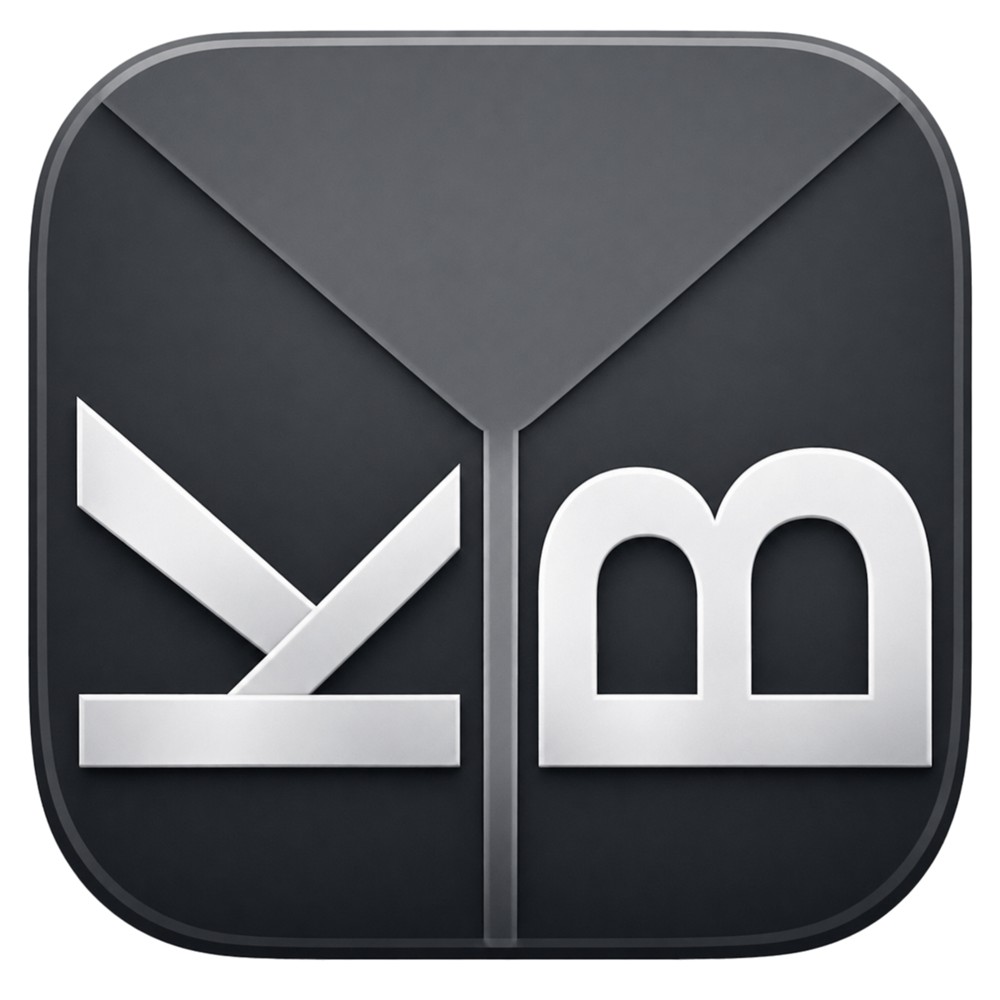
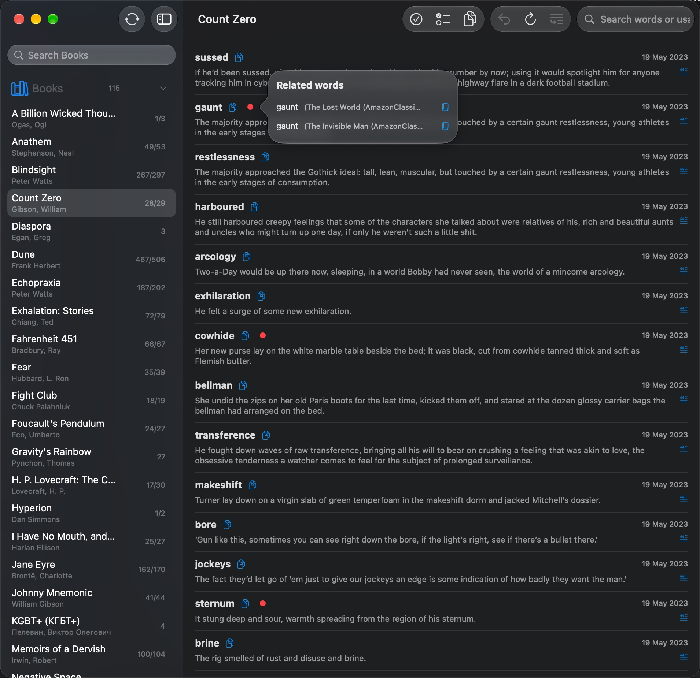

<p align="center">
  
</p>

# KindleBro
KindleBro is a small native macOS app for Apple silicon that helps you work through the words you look up on your Kindle, from the first lookup to finished flashcards.

It is made mainly for advanced language learners who use spaced repetition (SRS). Reading fiction is one of the most efficient ways to collect new vocabulary.

Inspired by [Kindle Mate](https://sourceforge.net/projects/kmate/). Free and open source under the [GPL-3.0](LICENSE).

## Features
### Kindle integration
- One-click sync imports `vocab.db` straight from a connected Kindle.
- Words are grouped by book, newest first, so you can process a book in batches as you read it.
- Different forms of a word in the same book, such as «vitiated» and «vitiates», are shown as one entry under the dictionary form («vitiate»). The entry keeps every form's sentences, and its status applies to all forms. Forms come from Apple's language tools (English and Russian), with Kindle's stem as a fallback for rare words.
- If the same book appears more than once (for example, words synced from two Kindles), it is shown as one book and each word appears once.
### Word processing
- Imported words start in the `Learning` state. From there you can mark them:
    - `Ignored`: words added by mistake (Kindle has no way to remove words from `vocab.db`).
    - `Mastered`: words you have already made flashcards for.
- The goal is to process every word. Once all words in a book are `Mastered` or `Ignored`, the book counts as `Completed` and moves to the Completed section, away from the books still in progress.
- Books in progress show `Learning/Total` in the sidebar, so you can see at a glance what is left.
- The Refresh button moves `Mastered` and `Ignored` words to the bottom of the list, which helps with batch processing in word-dense books.
- Each word comes with its usage, the sentence from the book where you looked it up. Context matters for remembering a word. If a word was looked up several times in the same book, a chevron appears and you can pick the usage to use from then on. The choice is saved per book, so the same word in another book keeps its own usage.

> [!note]  
> In my experiments, flashcards with several usages were harder to recall than cards with one, because each card held too much. So the app keeps one preferred usage per word.
- A word's status is shared across books: marking it `Mastered` in one book marks it everywhere.
- Undo reverts status changes. A batch change, such as an arrow key press on several selected words, is undone in one step.
- Automatic backup: when you quit, KindleBro can copy your whole library to a folder you choose (Dropbox or iCloud Drive, for example) using SQLite's backup API. Changing the backup settings also makes a full backup right away. If a backup fails, you get an alert; for a backup on quit, the alert appears at the next launch.

### Keyboard-driven review
- Right Arrow:
    - `Learning` → `Mastered`
    - `Ignored` → `Learning`
- Left Arrow:
    - `Learning` → `Ignored`
    - `Mastered` → `Learning`
- Esc clears the selection.
- Cmd + C copies the selected words with their primary usage.
- Cmd + Shift + P opens the prompt editor.
- Cmd + , opens Settings.
- Each word has copy icons for copying the word or its usage on its own.
- Hold Command to select several words.
- Toolbar buttons:
    - `Select learning batch` selects the first batch of `Learning` words in the current book (the batch size is set in Settings).
    - `Select all Learning words`
    - `Copy all Learning words`
    - `Copy selected words with prompt`
### Search
- Book search filters the book list by title.
- Global search looks through the whole library, both words and their usages.
    - For English it also matches other forms of a word: «peeved» finds «peeve». Usage text is matched literally.
    - `%` and `_` are searched as plain characters.
    - Clicking a result opens its book and selects the word.
- Related words: words with the same dictionary form in other books are marked with a red dot. Click it to see them and jump to one. You can turn this off in Settings, along with stem-based search.
### Library
- Import a `vocab.db` from any location with File ▸ Import Database….
- You can import several `vocab.db` files into one library. Imports only add: existing word states are kept. An import either completes fully or changes nothing, and any error is shown.
- The library can be exported as a backup, including word states, preferred usages and the custom prompt.
- The library can be erased.
### Flashcards prompt
- You write the prompt that turns words into flashcards, in whatever format you need. `Copy selected words with prompt` puts the prompt in front of the words; paste the result into the LLM chat of your choice.
- Optionally, words copied with a prompt are marked `Mastered` automatically.

Example prompt:
```
For a given set of words and usage samples, generate flashcards in the following format:

word>>3 most frequent translations, ordered by descending frequency, with the most frequent translation wrapped in **bold**. After the translations, add a usage sample enclosed in backticks (``). At least one translation must be derived from the provided usage. If a word has fewer than three frequent translations, list only the available ones.  
Each flashcard must be on a new line. Do not add any text, comments, or explanations — output **only** the generated flashcards.

Example:  
test>>**translation1**, translation2, translation3 `Usage example`
```
> [!tip]  
> You can change the card format by editing the prompt.

## Install
After installing from the `.dmg`, remove the quarantine attribute:
```
xattr -d com.apple.quarantine /Applications/KindleBro.app
```

## Local build
Run `./package.sh` to build the `.app` and the `.dmg` installer.

Use Xcode if you can. It builds against the latest macOS SDK, which gives the app the Liquid Glass design. With only the Command Line Tools installed, the macOS 27 SDK lacks SwiftUI's macro plugin, so `package.sh` falls back to the macOS 26 SDK. Either way the app runs on macOS 14 and later.

Run the tests with `swift test`. With only the Command Line Tools, pass the SDK and the Swift Testing macro plugin explicitly:
```
SDKROOT=/Library/Developer/CommandLineTools/SDKs/MacOSX26.sdk swift test -Xswiftc -load-plugin-library -Xswiftc /Library/Developer/CommandLineTools/usr/lib/swift/host/plugins/testing/libTestingMacros.dylib
```
## Suggested workflow
Once the app is set up:
- Finish a book.
- Connect your Kindle and press Sync to import the new words.
- Open the book and go through all its words:
    - Mark mistakes and irrelevant words `Ignored`.
    - Mark words you already know `Mastered`.
- Press Refresh to move `Mastered` and `Ignored` words to the bottom.
- Press Select all Learning words.
- Press Copy with prompt and paste into an LLM chat to generate the flashcards.
- Paste the flashcards into your SRS app. With a good prompt, they need no further formatting.
> [!tip]  
> For word-heavy books, keep batches to about 100 words.
